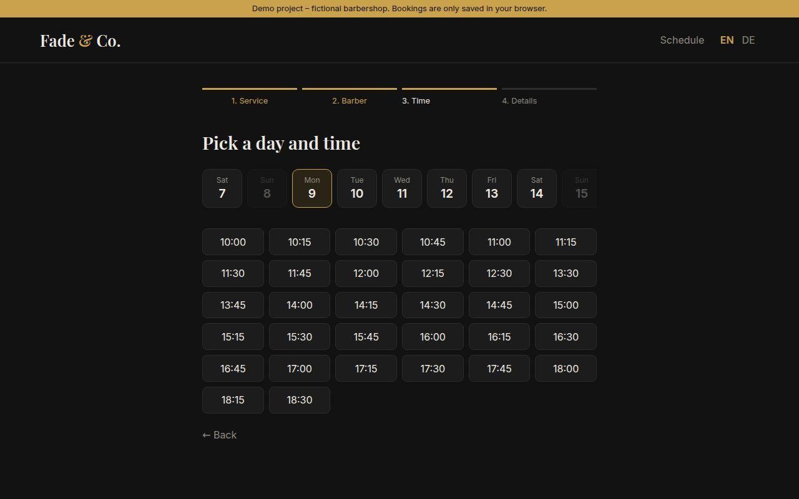
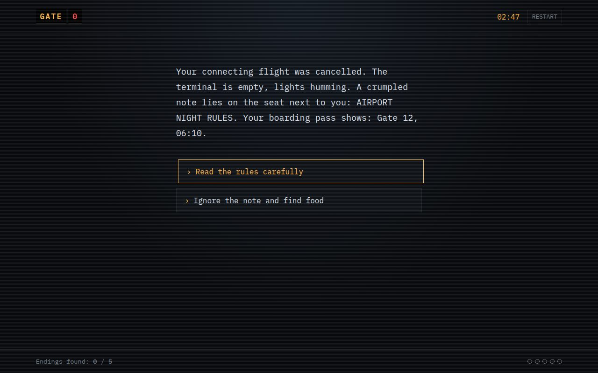
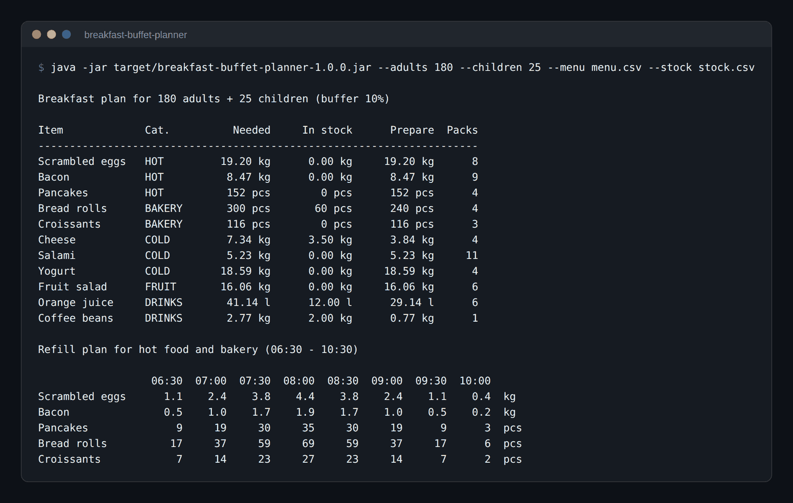
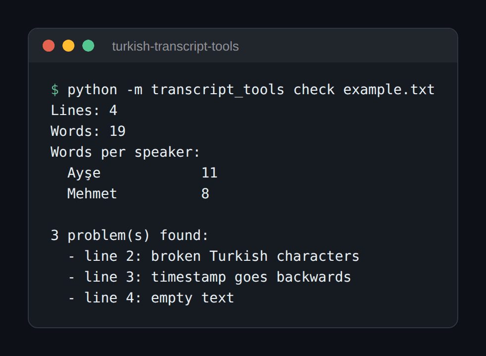
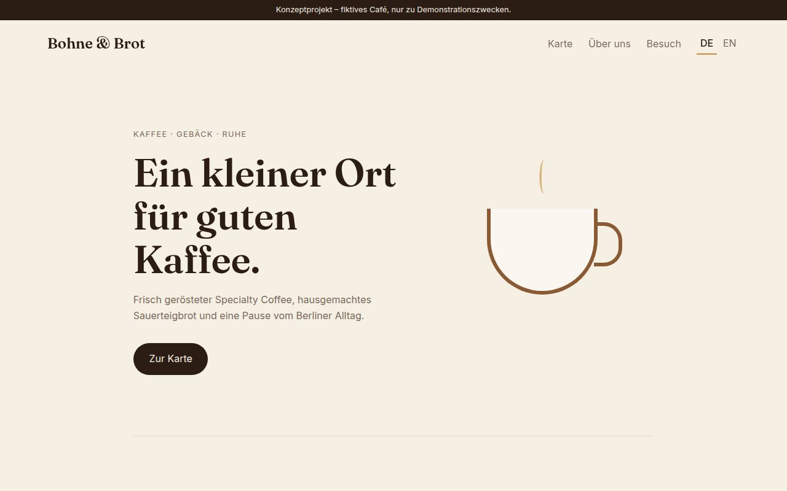
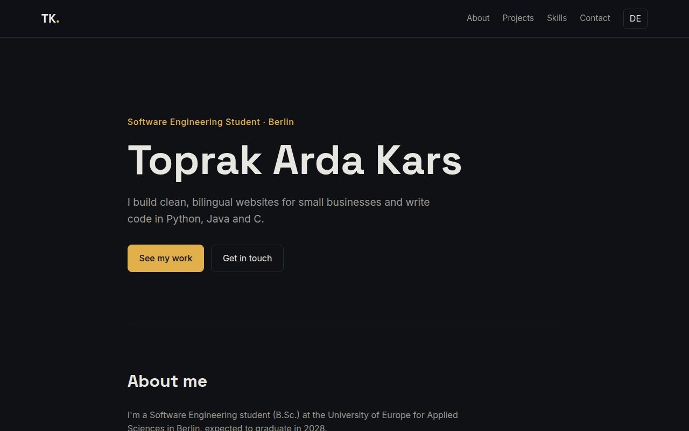

## Hi, I'm Toprak 👋

Software Engineering student at the **University of Europe for Applied Sciences** in Berlin (B.Sc., expected 2028).
I build websites for small businesses and like turning ideas into clean, working pages.

- 🌍 Based in Berlin, Germany
- 🗣️ Turkish (native) · English (C1) · German (A1)
- 🎧 Freelance Turkish transcriptionist — remote, guideline-driven audio projects
- 🌐 Portfolio: [toprakkars.github.io](https://toprakkars.github.io)
- 💼 [LinkedIn](https://www.linkedin.com/in/toprak-arda-kars-2a7a80303/)

### 🛠️ Tech I use

### 📌 Projects

| Project | What it is | Live |
|---|---|---|
| [barbershop-booking-app](https://github.com/ToprakKars/barbershop-booking-app) | Booking app with real slot-availability logic, schedule view, tests and a Google Sheets backend | [demo](https://toprakkars.github.io/barbershop-booking-app/) |
| [gate-0](https://github.com/ToprakKars/gate-0) | Interactive rule-horror story game – the story is checked automatically for dead ends (BFS) | [play](https://toprakkars.github.io/gate-0/) |
| [breakfast-buffet-planner](https://github.com/ToprakKars/breakfast-buffet-planner) | Java CLI that plans hotel breakfast amounts, orders and refills (Maven, JUnit 5) | – |
| [turkish-transcript-tools](https://github.com/ToprakKars/turkish-transcript-tools) | Python CLI to clean and check Turkish transcripts | – |
| [cafe-website-concept](https://github.com/ToprakKars/cafe-website-concept) | Bilingual landing page concept for a minimalist Berlin café | [demo](https://toprakkars.github.io/cafe-website-concept/) |
| [toprakkars.github.io](https://github.com/ToprakKars/toprakkars.github.io) | My personal portfolio site (HTML, CSS, JS, EN/DE) | [site](https://toprakkars.github.io) |

Every project with logic has automated tests that run on GitHub Actions.

<table>
  <tr>
    <td width="50%"> <b>Barbershop Booking App</b> – free slots are calculated, not hard-coded</td>
    <td width="50%"> <b>Gate 0</b> – choose-your-path story game with 5 endings</td>
  </tr>
  <tr>
    <td width="50%"> <b>Breakfast Buffet Planner</b> – amounts, orders and a refill plan for the morning rush</td>
    <td width="50%"> <b>Turkish Transcript Tools</b> – finds broken characters, bad timestamps and empty lines</td>
  </tr>
  <tr>
    <td width="50%"> <b>Bohne &amp; Brot</b> – bilingual café landing page</td>
    <td width="50%"> <b>Portfolio</b> – toprakkars.github.io</td>
  </tr>
</table>

Screenshots are taken automatically by a <a href=".github/workflows/screenshots.yml">GitHub Actions workflow</a> that opens the live sites and runs the command-line tools.

### 🎯 Currently

- Studying software engineering (3rd semester)
- Building websites for local Berlin businesses
- Open to remote, part-time work in language evaluation, AI training data and web development
